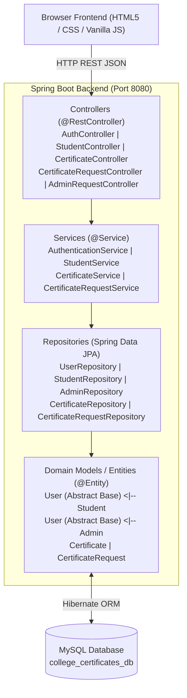
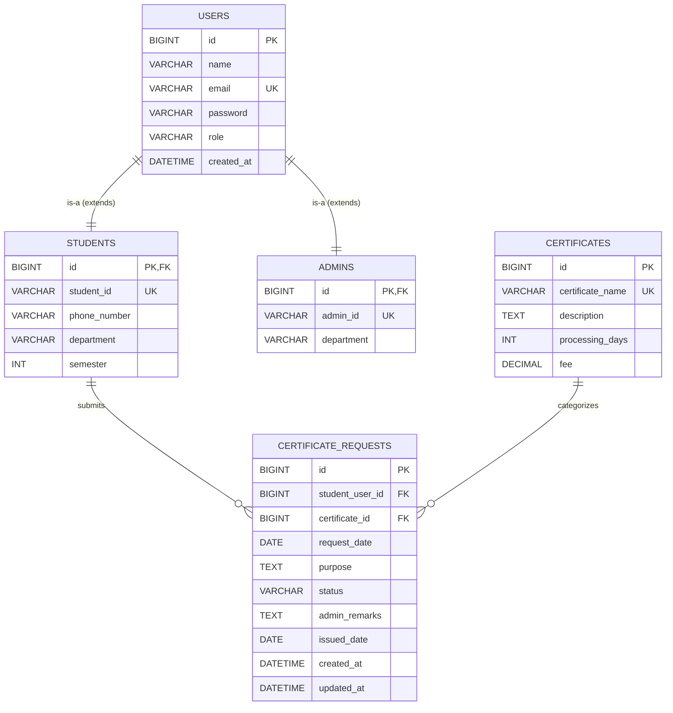

# College Certificate Request & Tracking System

A full-stack, Object-Oriented Java project built with **Spring Boot 3**, **Spring Data JPA**, **MySQL**, and a responsive **HTML5/CSS3/JavaScript** frontend.

---

## 🏛️ System Architecture



---

## 🌟 Key Features

1. **User Profile Management**:
   - Distinct roles: `STUDENT` and `ADMIN`.
   - Students can view and update their profile details (Name, Contact Number, Department, Semester).
2. **Certificate Catalogue & Dynamic Requesting**:
   - Bonafide, Course, Conduct, Transfer, and Migration certificates.
   - Dynamic fee and estimated processing day preview.
   - Duplicate active request prevention.
3. **Application Lifecycle Tracking**:
   - Allowed lifecycle path: `SUBMITTED → UNDER_REVIEW → APPROVED → ISSUED`
   - Alternative path: `SUBMITTED → UNDER_REVIEW → REJECTED`
   - Early cancellation: Students can cancel requests while still in `SUBMITTED` status.
4. **Administrative Review & Issuance Hub**:
   - Status-based filtering (`ALL`, `SUBMITTED`, `UNDER_REVIEW`, `APPROVED`, `ISSUED`, `REJECTED`).
   - Modal inspection of complete student and certificate details.
   - Contextual actions: Mark Under Review, Approve, Reject with mandatory reason, Issue with date timestamping.
5. **Supporting Document Upload**:
   - Students can attach verification documents (Student ID, Marksheet, Clearance Slip, Fee Receipt) in PDF, PNG, or JPG format.
   - Drag-and-drop dropzone with file preview and size validation.
   - Administrators can inspect attached documents directly in the review modal.
6. **Official Online Certificate Copy**:
   - When an application is marked `ISSUED`, a unique certificate registration number is generated (e.g. `CERT-2026-0004-9812A`).
   - Students can view and print/download an official, high-resolution digital certificate copy complete with college letterhead, official seals, and security verification hashes directly on their tracking page.

---

## 💡 Object-Oriented Programming (OOP) Mapping

| OOP Concept | Project Implementation |
| :--- | :--- |
| **Classes & Objects** | `User`, `Student`, `Admin`, `Certificate`, `CertificateRequest`. |
| **Encapsulation** | Private member variables, getters/setters, defensive validation methods (e.g. `isCancellable()`, `canTransitionTo()`). |
| **Inheritance** | Base abstract class `User` extended by `Student` and `Admin` using JPA `@Inheritance(strategy = InheritanceType.JOINED)`. |
| **Abstraction** | Service interfaces (`IAuthenticationService`, `IStudentService`, `ICertificateService`, `ICertificateRequestService`) decouple controllers from implementations. Abstract methods in `User` (`getRoleDescription()`, `getIdentifier()`). |
| **Polymorphism** | Overridden methods across subclasses (`getRoleDescription()`); interchangeable handling of user types. |
| **Method Overloading** | Overloaded query methods in `ICertificateRequestService`: `getAllRequests()` vs `getAllRequests(RequestStatus status)`. |
| **Method Overriding** | Subclass-specific `toString()` and abstract contract implementations. |
| **Exception Handling** | Custom runtime exceptions (`ResourceNotFoundException`, `DuplicateRequestException`, `InvalidStatusTransitionException`, `UnauthorizedException`) handled centrally by `@RestControllerAdvice`. |
| **Collections** | Extensive use of `List<CertificateRequest>`, `List<Certificate>`, `Map<String, String>` for data transfer and validation. |

---

## 🗄️ Database Design



---

## 🚀 Getting Started

### 1. Database Setup (MySQL)
Make sure MySQL server (via MySQL Workbench, CLI, or XAMPP) is running on port 3306.
1. Run the script located at `src/main/resources/database.sql` in MySQL.
2. Verify credentials in `src/main/resources/application.properties`:
   ```properties
   spring.datasource.url=jdbc:mysql://localhost:3306/college_certificates_db?useSSL=false&serverTimezone=UTC&allowPublicKeyRetrieval=true&createDatabaseIfNotExist=true
   spring.datasource.username=root
   spring.datasource.password=root
   ```

### 2. Running Backend (Spring Boot)
- **Via VS Code / IntelliJ IDEA**:
  - Open the `college-certificate-system` folder.
  - Run `CollegeCertificateSystemApplication.java`.
- **Via Maven Terminal**:
  ```bash
  mvn spring-boot:run
  ```
  The API will start at `http://localhost:8080/api`.

### 3. Running Frontend
- Open `frontend/index.html` in any web browser, or serve it using VS Code's **Live Server** extension.

### 4. Default Seed Credentials
- **Student**:
  - Student ID: `STU2024001` or Email: `john.doe@college.edu`
  - Password: `student123`
- **Admin**:
  - Email: `admin@college.edu` or Admin ID: `ADM101`
  - Password: `admin123`
